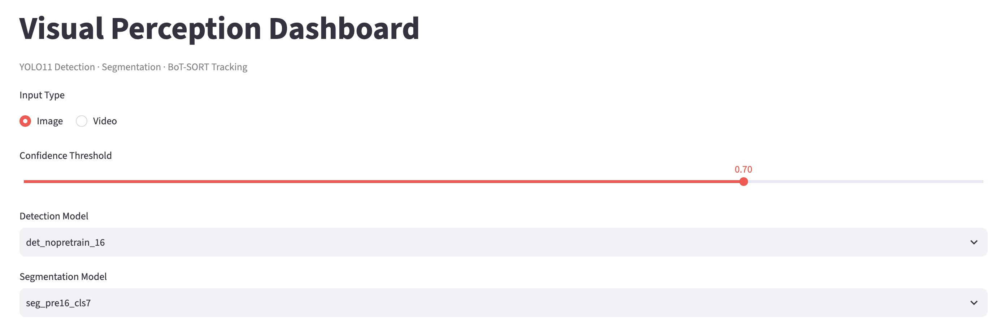
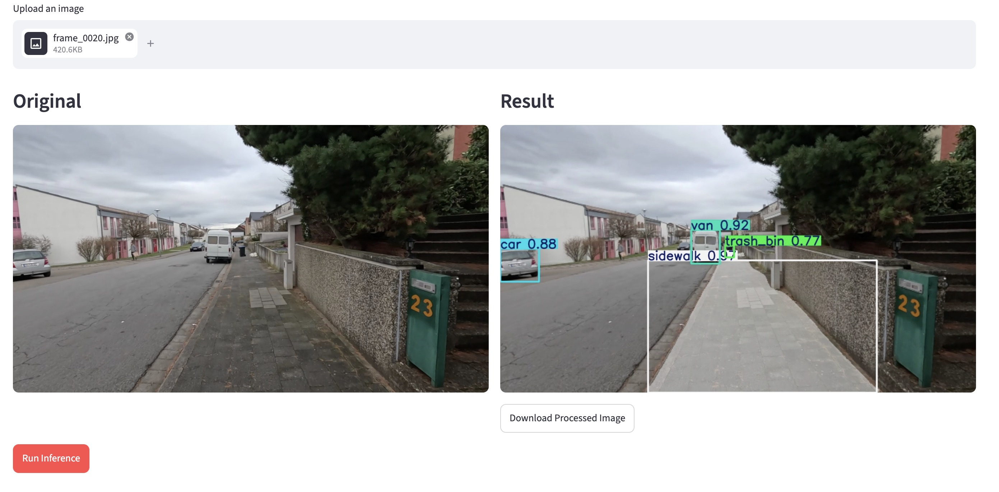

# YOLO11 Detection, Segmentation & Tracking

A computer vision application integrating **YOLO11**, **BoT-SORT with OSNet ReID**, **FastAPI**, and **Streamlit** for object detection, segmentation, and multi-object tracking.

## Features

- **Object Detection:** YOLO11-based object detection.
- **Segmentation:** Pixel-level segmentation of video and image scenes.
- **Multi-Object Tracking:** BoT-SORT with OSNet ReID for object identity association.
- **Web Interface:** Streamlit dashboard for uploading images and videos, selecting models, and visualizing results.
- **REST API:** FastAPI backend for image and video inference.
- **Docker Deployment:** Containerized frontend and backend using Docker Compose.

## Tech Stack

Python · PyTorch · YOLO11 · BoT-SORT · OSNet ReID · OpenCV · FastAPI · Streamlit · Docker

## Quick Start

**Requirements:** Docker and Docker Compose.

Clone the repository:

```bash
git clone https://github.com/DuckinGerman/YOLO11-det-seg-track.git
cd YOLO11-det-seg-track
```

Build and start the application:

```bash
docker compose up --build
```

Open the application:

- **Streamlit Dashboard:** http://localhost:8501
- **FastAPI Documentation:** http://localhost:8000/docs

## Usage

1. Upload an image or video through the Streamlit dashboard.
2. Select the detection and segmentation models.
3. Adjust the confidence threshold.
4. Run inference and visualize the results.
5. Download the processed image or video.

## Architecture

```text
Image / Video
     |
Streamlit Frontend
     |
FastAPI Backend
     |
     +-- YOLO11 Detection
     +-- YOLO11 Segmentation
     +-- BoT-SORT + OSNet ReID
     |
Processed Image / Video
```

## Demo

The dashboard supports image and video uploads, model selection,
inference visualization, and result downloads.





## Notes

- Inference runs on CPU in the provided Docker configuration.
- Video processing speed depends on hardware and input resolution.
- This repository includes a customized Ultralytics implementation for tracking with OSNet ReID.